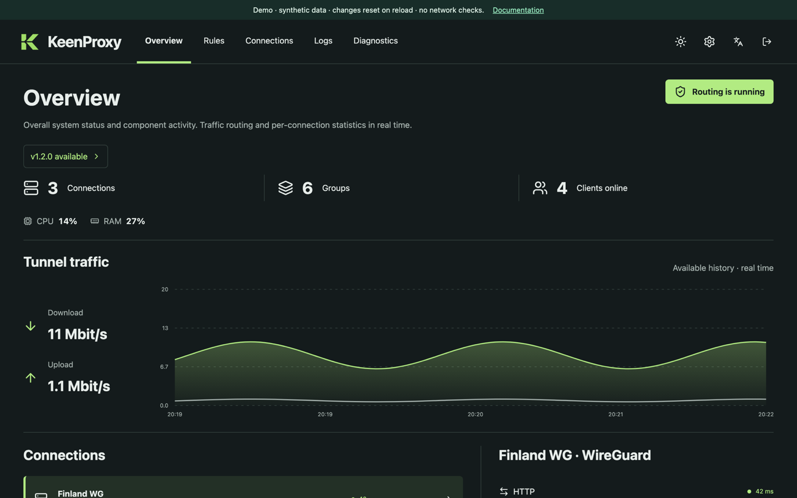

  

<h3 align="center">Infrastructure tools for home and small office.</h3>

  Ordo Systems builds software that keeps SOHO infrastructure in order, from the network edge to builds and deployments, without the weight of enterprise tooling.

  <a href="https://ordo-systems.github.io/">ordo-systems.github.io</a>

---

**Runs on what you have.** Made for routers, home servers, and small clusters, not datacenters. 
**Configuration you can read.** Plain files you can review, version, and roll back. 
**One job, done well.** Focused tools that fit into your setup instead of taking it over.

## Featured project

###  [KeenProxy](https://github.com/ordo-systems/keen-proxy) · *experimental*

Selective traffic routing for Keenetic and Netcraze routers running Entware. Choose which devices, domains, IP ranges, and countries go through a tunnel, connect directly, or are blocked, all from one web panel. KeenProxy embeds the [sing-box](https://github.com/SagerNet/sing-box) engine and can install, schedule, and roll back its own updates.

- **Device and network policies:** split routing, full tunneling, or direct access, with per-device overrides by MAC address.
- **Domain, IP, and country groups:** route by TLS SNI or HTTP Host, CIDR ranges, or country, including country exclusions.
- **WireGuard and sing-box connections:** failover with recovery hysteresis and explicit direct fallback where configured.
- **DNS under your control:** UDP/TCP frontend, DoH and DoT, selectable DNS routing, and DNS-only blocklists.
- **Diagnostics built in:** routing, audit, and system journals, connection statistics, and HTTP/HTTPS checks.

[**Try the live demo**](https://ordo-systems.github.io/keen-proxy/demo/) · [Documentation](https://ordo-systems.github.io/keen-proxy/) ([Русский](https://ordo-systems.github.io/keen-proxy/ru/)) · [Source](https://github.com/ordo-systems/keen-proxy)

